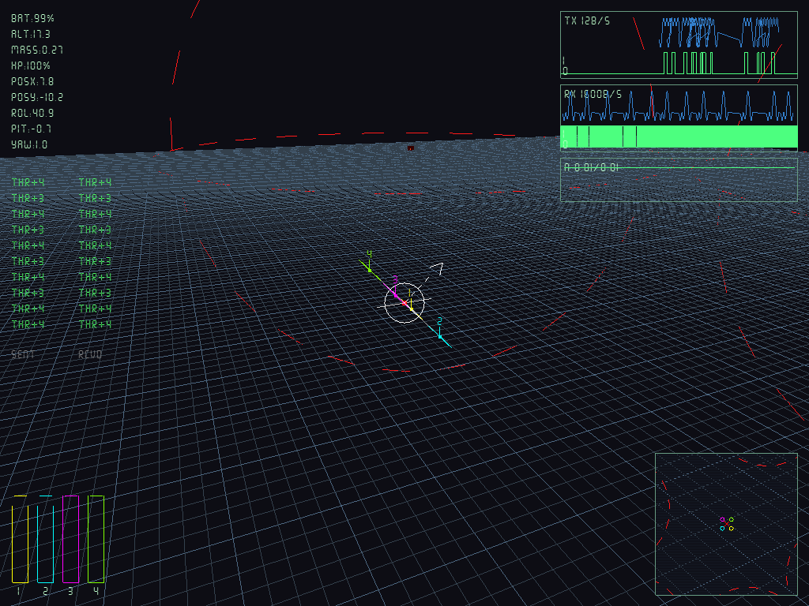
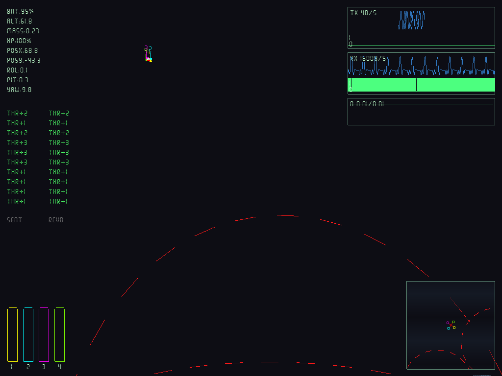
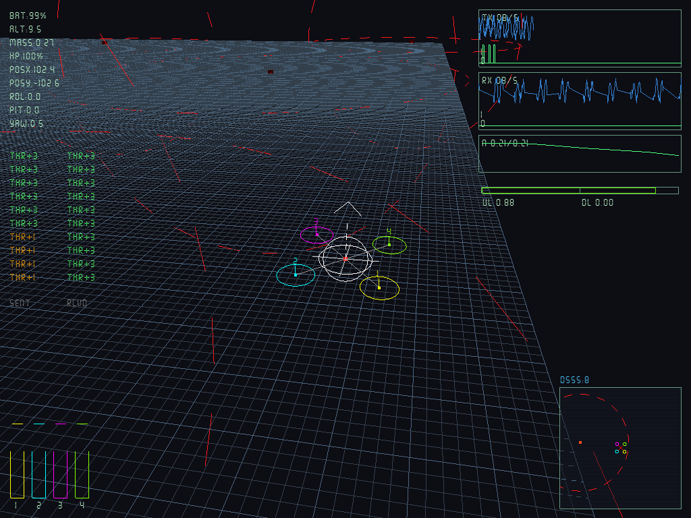
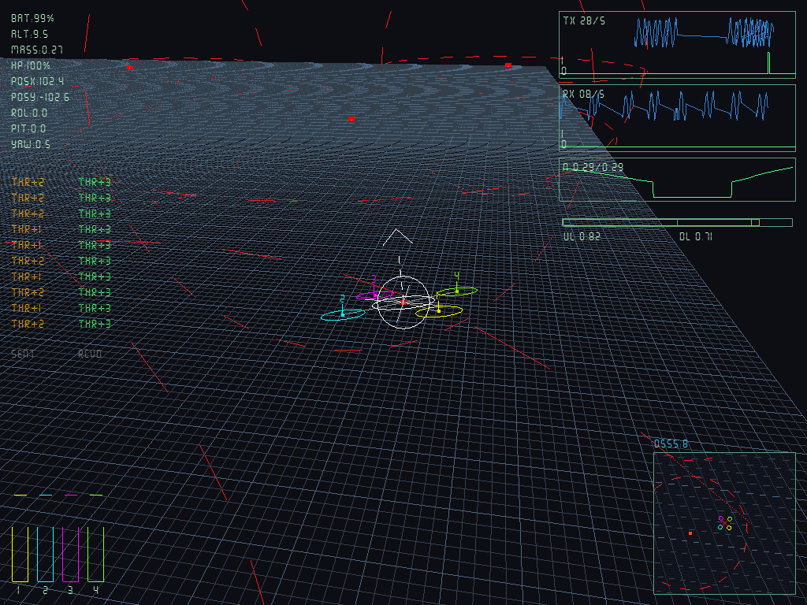
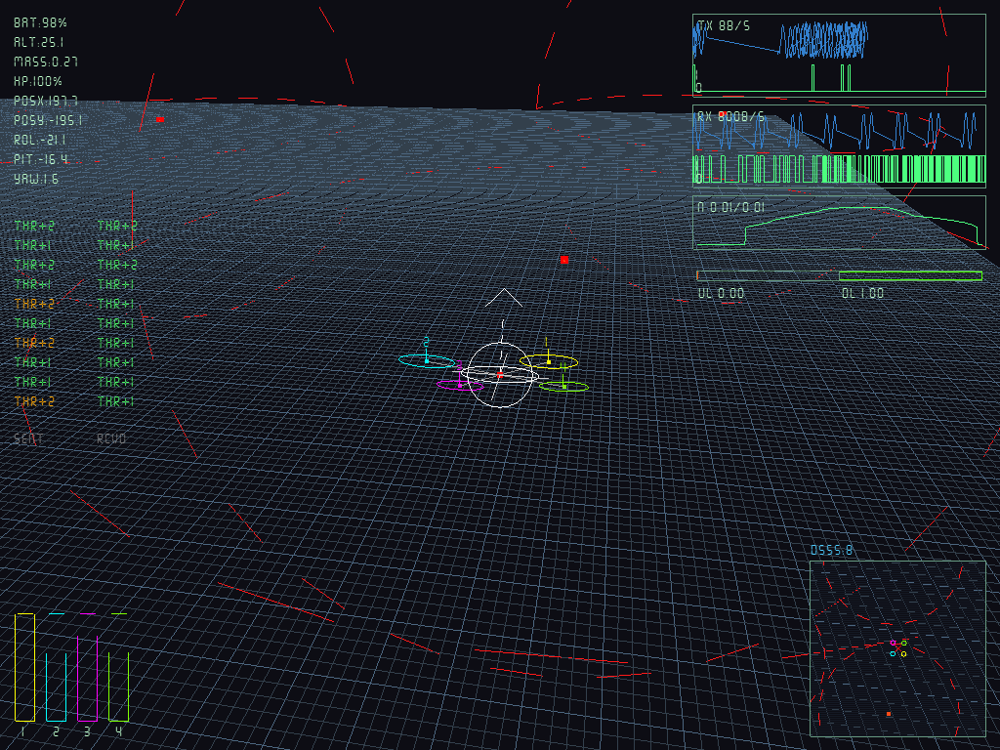

# UAVSIM

Python quadcopter (UAV) simulator built to study what radio jamming does
to a drone's control link, and what can be done about it. Real
X-configuration 4-motor physics, an onboard flight controller with
failsafe, an RC uplink and telemetry downlink that go through a real
(GNU Radio) or approximate (numpy) radio, jammers, and an OSD-style HUD.

None of the UAV's movement is explicitly scripted: the flight controller
outputs four motor commands, each motor spins up with a realistic lag,
thrust and torque are integrated over a rigid body, and the motion is an
emergent outcome of that physics.

## Gallery

| General view | Free camera |
|---|---|
|  |  |

| Approaching jammer | Inside jammer range | Leaving jammer |
|---|---|---|
|  |  |  |

## Installation

**1. GNU Radio** (not a pip package — install via your system package manager):

```bash
# Ubuntu/Debian
sudo apt-get install gnuradio

# Fedora
sudo dnf install gnuradio gnuradio-devel

# Arch
sudo pacman -S gnuradio

# macOS (Homebrew)
brew install gnuradio

# Cross-platform via conda:
conda install -c conda-forge gnuradio
```

Verify it's installed and importable from the Python you'll use:

```bash
python3 -c "from gnuradio import gr, blocks, digital, channels; print(gr.version())"
```

⚠️ **If you see `gr::vmcircbuf :error: shmat (2): Invalid argument` at runtime**:
GNU Radio's shared-memory vmcircbuf can fail on some systems. Set this env
var before running (or add it to your `~/.bashrc`):

```bash
export GR_SCHEDULER=STS
```

⚠️ **If you get a NumPy error like "compiled using NumPy 1.x cannot be run in NumPy 2.x"**:
your distro's GNU Radio was compiled against NumPy 1.x. Downgrade numpy in
that environment (`pip install "numpy<2" --force-reinstall`) — this is what
`requirements.txt` pins. This is a limitation of your system's GNU Radio
package, not of this project.

**2. Remaining dependencies with pip:**

```bash
python -m venv .venv
source .venv/bin/activate  # on Windows: .venv\Scripts\activate
pip install -r requirements.txt
```

If using a venv, make sure GNU Radio is visible from inside it (system
packages go to `/usr/lib/python3/dist-packages`, which venvs don't always
inherit — if the import fails only inside the venv, run `main.py` with the
system Python instead, or create the venv with `--system-site-packages`).

## Run

```bash
python main.py                 # GNU Radio if installed, numpy link otherwise
python main.py --link loopback # force the fast approximate numpy radio
```

`--link loopback` needs only `numpy scipy pygame PyOpenGL` and runs on
Windows. It keeps the same frame structure (unspread 32-bit sync word,
CRC32, optional DSSS) but replaces the DSP with a calibrated bit-error
model, so use GNU Radio for results you want to report.

Tests (headless, no GNU Radio or display needed):

```bash
pip install pytest
python -m pytest
```

## Controls

You fly it like a real drone: the sticks go to an **onboard flight
controller**, never to individual motors. The transmitter sends the
absolute stick positions 50 times per second (like SBUS / CRSF / ELRS),
so a lost frame is simply replaced by the next one.

**Sticks** (Mode 2 layout, left hand W A S D, right hand I J K L):

| Key       | Stick                 | ALT / POS hold          | ANGLE / ACRO            |
|-----------|-----------------------|-------------------------|-------------------------|
| `W` / `S` | throttle              | climb / descend (spring)| raise / lower (stays)   |
| `A` / `D` | yaw                   | turn left / right       | turn left / right       |
| `I` / `K` | pitch                 | forward / back          | nose down / up          |
| `J` / `L` | roll                  | left / right            | bank left / right       |

**Switches**

| Key     | Action |
|---------|--------|
| `SPACE` | Arm switch. Arming needs the UAV on the ground, the throttle low, and the switch seen OFF first |
| `M`     | Flight mode: `POS` → `ALT` → `ANGLE` → `ACRO` |
| `G`     | Failsafe action: `RTH` → `HOLD` → `LAND` → `DROP` |
| `X`     | Transmitter on/off — kill the link on purpose to test the failsafe |

A **gamepad** is used automatically when connected: left stick
yaw/throttle, right stick roll/pitch, `A` arm, `B` mode, `Y` failsafe
action (axis/button numbers are at the top of `rendering/window.py`).

**Flight modes**

- `POS` (position hold): sticks command velocity; centred = hover in place. Easiest.
- `ALT` (altitude hold, default): sticks command tilt; throttle centred = hold altitude.
- `ANGLE`: sticks command tilt; throttle is raw collective thrust (hover ≈ 41%).
- `ACRO`: sticks command rotation rates; nothing self-levels.

**Failsafe** (what the drone does when the uplink is jammed):

1. No valid frame for 0.1 s → `RX LOSS`: keep flying on the last sticks.
2. After 0.3 s → sticks centred, the aircraft self-levels (ACRO becomes ANGLE).
3. After 1.0 s → the selected action: `RTH` (climb to 15 m, fly home,
   land, disarm), `HOLD` (hover in place), `LAND` (descend 1 m/s, disarm)
   or `DROP` (cut motors).

Stages 1–2 recover as soon as frames arrive again. Stage 3 hands control
back only after the link has been good for 0.5 s **and** the pilot moves
a stick, so drifting out of a jammer's range does not drop a hands-off
pilot back into manual mid-air. The position estimate is perfect (an
ideal GNSS); GNSS jamming is not modelled yet.

**Camera and simulation** (never first-person — always an external observer):

| Key          | Action |
|--------------|--------|
| Arrow keys   | FREE mode: move the camera. FOLLOW mode: orbit / zoom |
| Mouse        | Rotate view (orbit in FOLLOW, look around in FREE) |
| `V`          | Toggle between FOLLOW (chases the UAV) and FREE (spectator) |
| `F`          | Toggle chaotic DSSS anti-jamming (N=8) on/off |
| `P`          | Pause / unpause (camera keeps working while paused) |
| `BACKSPACE`  | Reset UAV + randomly reposition all jammers |
| `F12`        | Save screenshot to `assets/images/` |
| `ESC`        | Quit |

When pressing `V` the camera doesn't "jump": it keeps the current viewpoint
and only changes how it's controlled from there onward.

## HUD

Flight data comes only from the telemetry the UAV transmits, never from
reading the UAV directly — when the downlink is jammed the numbers turn
grey and freeze (`TLM LOST`), just like a real ground station.

- **Flight data** — `BAT`, `ALT`, `VZ` (climb rate), `SPD` (ground speed),
  `HP`, `POSX`/`POSY`, `ROL`/`PIT`/`YAW`.
- **Transmitter state** — `MODE`, `ARM` switch, `FS` (failsafe action),
  radio backend, `PAD` when a gamepad is in use.
- **Link quality** — `LQ UP` is the % of RC frames the UAV actually
  received over the last second (it measures it and reports it in
  telemetry); `LQ DN` is the % of telemetry packets the ground station
  received. Green ≥ 80, amber ≥ 40, red below.
- **Stick monitor** — `TX` shows the sticks the pilot is sending, `RX`
  the sticks the UAV is actually applying. They diverge during a failsafe.
- **Banner** — `DISARMED`, `RX LOSS`, `FAILSAFE RTH/HOLD/LAND/DROP`,
  `TLM LOST`, `TX OFF`.
- **Motor bars** — the four motor commands from the flight controller.
- **Minimap** — top-down view around the UAV with jammers and the home
  point (cyan square). In the 3D view the home point is a cyan `H` and a
  dashed drop line marks the UAV's position over the ground.
- **TX / RX scopes, noise timeline, DSSS correlation meter** — the real
  bits and waveform of each burst, noise voltage on each link, and DSSS
  correlation quality when anti-jamming is on (`F`).

## Communication: Real GNU Radio, not an in-memory queue

The Operator and the UAV are each other's transmitter and receiver (the
Operator transmits commands, the UAV transmits telemetry), and **the signal
between them actually travels through GNU Radio**: real GMSK modulation, a
simulated AWGN channel (`channels.channel_model`), real demodulation, and
access-code synchronization (`digital.correlate_access_code_tag_bb`). This
is not a Python queue pretending to be a radio.

Each direction (`command_link`, `telemetry_link`) is an independent
`GnuRadioChannel` with its own background thread:

```
send(bytes) -> [preamble + access code + payload + CRC32 + tail padding]
             -> digital.gmsk_mod (real modulation)
             -> channels.channel_model (simulated AWGN noise)
             -> digital.gmsk_demod (real demodulation)
             -> digital.correlate_access_code_tag_bb (real sync)
             -> CRC32 verification
             -> recovered bytes (or the packet is lost, just like a real radio)
```

Real consequences, not cosmetic:

- **Packets can be lost or corrupted**: with low noise (default
  `noise_voltage=0.05`) almost everything arrives intact, but it's a real
  radio, not a guarantee. If the access code doesn't sync or CRC32 fails,
  the packet is dropped — corrupted data is never delivered to the app
  (`UAV`/`Operator` silently ignore corrupt packets, they don't crash).
- **Delivery is asynchronous with real jitter**: each burst (encode +
  modulate + pass through the channel + demodulate) costs ~10ms of real CPU
  time, so it runs in a background process per channel, never blocking the
  main loop. RC frames (11 bytes) go out at 50 Hz and telemetry (174 bytes)
  at 10 Hz, below the measured ~100 bursts/sec per worker ceiling.
- **Longer packets die first**: at the same noise level the 174-byte
  telemetry packet is far more likely to fail its CRC than the 11-byte RC
  frame, so inside a jammer you often keep some control but lose the
  telemetry (`LQ UP` stays up while `LQ DN` drops).

## Architecture

```
uavsim/
├── control/
│   ├── rc.py              RCPacket: 11-byte absolute-stick frame, FlightMode, FailsafeAction
│   ├── pid.py             PID (vector, integrator clamp, derivative on measurement)
│   ├── flight_controller.py  Cascaded position/velocity/attitude/rate loops + mixer
│   └── failsafe.py        LinkMonitor (LQ) + staged failsafe (HOLD/LAND/RTH/DROP)
├── comms/
│   ├── telemetry.py       TelemetryPacket: state + applied sticks + uplink LQ + failsafe
│   ├── gnuradio_link.py   GnuRadioChannel: real GMSK + noisy channel + demod + CRC,
│   │                      in its own subprocess
│   ├── loopback_link.py   LoopbackChannel: same interface, statistical numpy model
│   ├── link_stats.py      TX/RX history + bandwidth shared by both backends
│   ├── comm_chaos_adapter.py DSSSChaotic + Lorenz-based spread/despread
│   └── gateway.py         CommGatewayInput/Output wrappers around a channel
├── physics/
│   ├── motor.py           Motor: command -> spin-up lag -> thrust ∝ speed² + yaw torque
│   ├── battery.py         Battery: drains based on motor load
│   └── rigid_body.py      RigidBody: 6DOF (numpy + scipy Rotation) + linear/quadratic drag
├── world/
│   └── environment.py     Flat ground, ground contact (gear sits flat), world bounds
├── entities/
│   ├── uav.py             UAV: frames in -> arming -> failsafe -> flight controller
│   │                      -> motors -> physics -> telemetry, at a fixed 250 Hz tick
│   ├── operator.py        UAVOperator: keyboard/gamepad -> sticks -> RC frames at 50 Hz;
│   │                      ground-station telemetry + downlink LQ
│   └── jammer.py          Jammer: noise level vs distance
├── hud/
│   └── hud.py             HUDSnapshot from telemetry + transmitter state + link stats
└── rendering/
    ├── window.py          Window + keyboard/gamepad/mouse input via pygame
    ├── camera.py          Camera: FOLLOW (orbit) and FREE (spectator) modes
    ├── ttf_font.py        TrueType texture atlas font renderer
    └── renderer.py        Terrain, UAV, jammers, home point, full HUD
tests/                     pytest: protocol, flight modes, failsafe, link model
```

Physics and control run at a **fixed 250 Hz in simulation time**
(`PHYSICS_HZ` in `main.py`), decoupled from the render frame rate; pausing
stops simulation time, so it never triggers a failsafe.

### Why the camera bug happened (historical)

Before, the UAV had no ground collision: it fell in free fall from frame 1
(gravity with nothing to stop it), and the camera was attached with a fixed
offset to the UAV's position. In a couple of seconds the drone fell so far
it exited the perspective far clipping plane → the screen turned to the
background color (near black). That also made the HUD appear "absent": the
scene broke almost instantly.

Now `apply_ground_contact()` stops the UAV at the floor until its own thrust
lifts it, and the camera never depends on the UAV's orientation (only its
position), so even if the drone tumbles from asymmetric thrust, the camera
doesn't "go crazy" with it.

### Design decisions

- **Real bit-level protocol**: `Command.encode()`/`decode()` pack each order
  into a real 1-byte packet, and the UAV decodes it via `CommGatewayInput`.
- **Telemetry with `struct`**: binary pack/unpack using the standard library.
- **Physics with `numpy` + `scipy.spatial.transform.Rotation`**: scipy
  quaternions instead of hand-rolled rotation matrices.
- **Strict layer separation**: `RigidBody` doesn't know what a motor or
  ground is; `Motor` doesn't know what a UAV is; `UAV` doesn't know about
  keyboards or cameras; `HUD` never talks to the UAV, only to what the
  `Operator` has already received; `Camera` knows nothing about physics or
  comms.

## References

The chaotic DSSS anti-jamming scheme implemented here is based on the
following papers (PDFs available in `docs/`):

1. **Souli, N.**, Stavrinides, S. G., Picos, R., Karatzia, M., Kolios, P.,
   & Ellinas, G. (2025). *Development of a Lightweight Secure Communication
   System for UAVs Enhanced by an Unconventional Chaotic Communication
   Architecture*. Journal of Intelligent & Robotic Systems, 111(3), 85.
   [DOI: 10.1007/s10846-025-02293-6](https://doi.org/10.1007/s10846-025-02293-6)

2. **Nwachioma, C.**, Ezuma, M., & Medaiyese, O. O. (2021). *FPGA
   prototyping of synchronized chaotic map for UAV secure communication*.
   2021 IEEE Aerospace Conference, 1–7.
   [DOI: 10.1109/AERO50100.2021.9438428](https://doi.org/10.1109/AERO50100.2021.9438428)

## Next steps (not yet implemented)

- Physical link budget: operator position, path loss, jammer power summed
  (not max), uplink and downlink jammed independently.
- More jammer types (tone, swept, pulsed, reactive) and GNSS jamming.
- Better mitigation: spread the sync word, soft-decision despreading,
  per-packet keyed sequences, FEC + interleaving, compact telemetry,
  adaptive spreading, frequency hopping.

- ~~Jammers~~ ✅ done — orange-red cylinders with dotted range circles that
  raise the noise floor on both radio links. Randomly placed at startup,
  repositioned on reset. The minimap shows their positions and range.
- Non-flat terrain.
- More realistic ground contact (real normal force instead of clamping).
