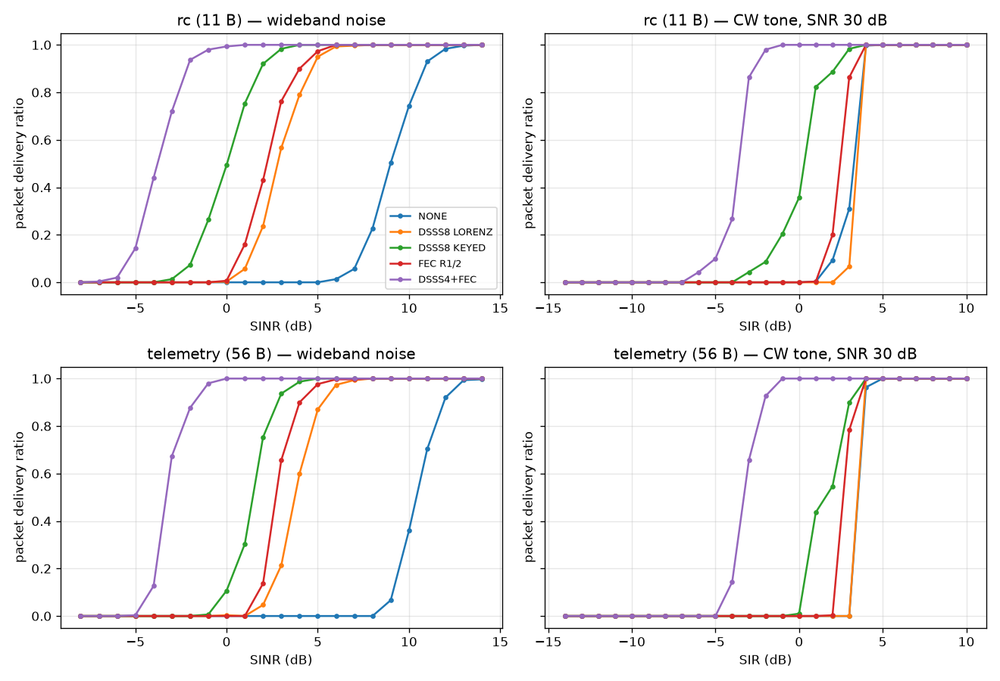

# Mitigation results

Measured with the bit-true numpy modem (`uavsim/comms/phy/`) and the
headless flight harness. Regenerate with:

```bash
python -m uavsim.experiments.link_curves --out docs/results --trials 300
python -m uavsim.experiments.jammer_approach --out docs/results --seeds 3
```

Files: `link_curves.png` / `link_curves.csv` (delivery curves),
`link_summary.md` / `.csv` (50% thresholds), `jammer_approach.md` / `.csv`
(closed-loop flights).

## Profiles compared

| Profile | What it does | Airtime (11 B frame) |
|---|---|---|
| NONE | plain frame: 32-bit sync word + payload + CRC32 | ×1 |
| DSSS8 LORENZ | the original scheme: 8 chips/bit from the Lorenz attractor, hard decisions, sync word not spread | ×6.5 |
| DSSS8 KEYED | 8 chips/bit from a keyed PRNG reseeded per packet, soft despreading, sync word spread | ×8 |
| FEC R1/2 | K=7 rate-1/2 convolutional code, soft Viterbi | ×1.9 |
| DSSS4+FEC | FEC, then 4 keyed chips per coded bit, spread sync word | ×7.5 |



## 1. Link level: SINR needed for 50% packet delivery

Wideband interference (barrage / pulsed / swept jammers, thermal noise):

| Profile | RC frame (11 B) | Telemetry (56 B) | Gain (RC) | Gain after paying for airtime |
|---|---|---|---|---|
| NONE | 9.0 dB | 10.4 dB | – | – |
| DSSS8 LORENZ | 2.8 dB | 3.7 dB | +6.2 dB | **−2.0 dB** |
| DSSS8 KEYED | 0.0 dB | 1.4 dB | +9.0 dB | −0.1 dB |
| FEC R1/2 | 2.2 dB | 2.7 dB | +6.8 dB | **+4.1 dB** |
| DSSS4+FEC | −3.8 dB | −3.3 dB | **+12.8 dB** | **+4.0 dB** |

Narrowband CW tone jammer on a clean link (SIR = signal / tone power):

| Profile | RC frame | Gain |
|---|---|---|
| NONE | 3.3 dB | – |
| DSSS8 LORENZ | 3.5 dB | **−0.2 dB** |
| DSSS8 KEYED | 0.3 dB | +3.0 dB |
| FEC R1/2 | 2.5 dB | +0.8 dB |
| DSSS4+FEC | −3.6 dB | **+6.9 dB** |

Tone rejection of keyed DSSS alone grows with the spreading factor:
+2.9 dB at N=8, +6.3 dB at N=16, +8.4 dB at N=32 (separate run, 200
packets per point). It stays ~6 dB under the textbook 10·log10(N): bit
errors are caused by the tone's *peak*, and short codes have heavy tails.

## 2. Closed loop: how close to a jammer the drone stays controllable

Jammer of 10 dBm, 150 m from the ground station; the UAV flies straight at
it at 10 m altitude in POS_HOLD. Distance to the jammer, median of 3 runs
(smaller = better):

| Jammer | Profile | LQ < 90% | First RX loss | Failsafe (link gone 1 s) |
|---|---|---|---|---|
| BARRAGE | NONE | 55 m | 47 m | 42 m |
| BARRAGE | DSSS8 LORENZ | 36 m | 31 m | 23 m |
| BARRAGE | DSSS8 KEYED | 28 m | 24 m | 20 m |
| BARRAGE | FEC R1/2 | 33 m | 30 m | 25 m |
| BARRAGE | DSSS4+FEC | 21 m | 17 m | **14 m** |
| TONE | NONE | 33 m | 32 m | 27 m |
| TONE | DSSS8 LORENZ | 33 m | 33 m | **31 m** (worse than none) |
| TONE | DSSS8 KEYED | 31 m | 25 m | 21 m |
| TONE | FEC R1/2 | 32 m | 32 m | 29 m |
| TONE | DSSS4+FEC | 20 m | 19 m | **12 m** |

## What this says

1. **Against wideband noise, spreading only buys what its airtime pays
   for.** DSSS with N=8 gains 9 dB for 8× the airtime: exactly what
   sending each bit 8 times would give. In a real system that is 8× less
   data rate (or 8× more bandwidth).
2. **The Lorenz sequence as implemented is a weak spreading code.** It
   changes sign every ~150 chips, so with N=8 almost every bit is
   multiplied by a constant. It loses 2–3 dB to a proper keyed sequence
   against noise (hard decisions + unspread sync word), and against a
   narrowband tone it rejects **nothing** — it does slightly worse than no
   spreading at all. It is also reproducible by anyone with the (public)
   initial conditions, and relies on both ends advancing in lockstep.
3. **Error correction is the only technique here with real gain** after
   accounting for airtime (+4 to +5 dB), and it helps the longer
   telemetry packet most.
4. **Best combination measured: DSSS4+FEC.** For about the same airtime as
   DSSS8 it needs ~4 dB less SINR, and it is the only profile that keeps a
   real margin against the tone jammer. In flight it keeps control until
   ~14 m from a barrage jammer instead of 42 m.
5. **Compacting telemetry** from 174 to 56 bytes buys ~0.9 dB on the
   downlink at no cost.

## Caveats

* Noise is fixed *per chip*: it models a jammer that keeps the same power
  spectral density over whatever bandwidth the radio uses. Real spread
  spectrum also forces a fixed-power jammer to spread its power thinner,
  which these numbers do not credit — they are conservative for DSSS.
* The modem is a calibrated model of the GMSK link (implementation loss
  K = 0.41), not GNU Radio itself. The GNU Radio backend still only
  implements the original Lorenz DSSS.
* Perfect timing and frequency sync are assumed; there is no fading,
  multipath or Doppler.
* The tone sits 0.0021 cycles/chip from the carrier with random phase per
  packet; other offsets will give somewhat different numbers.
